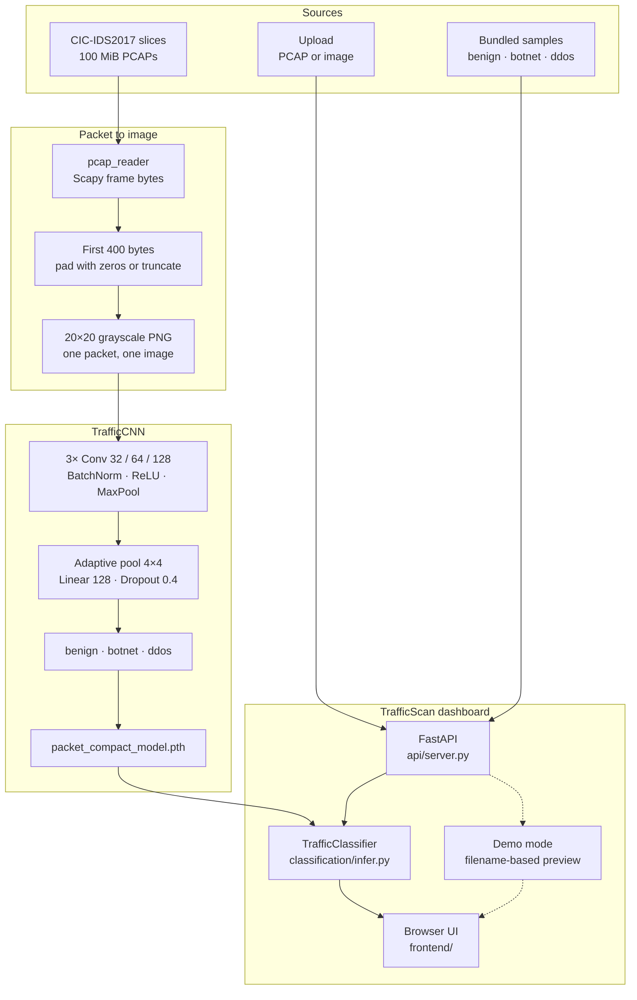
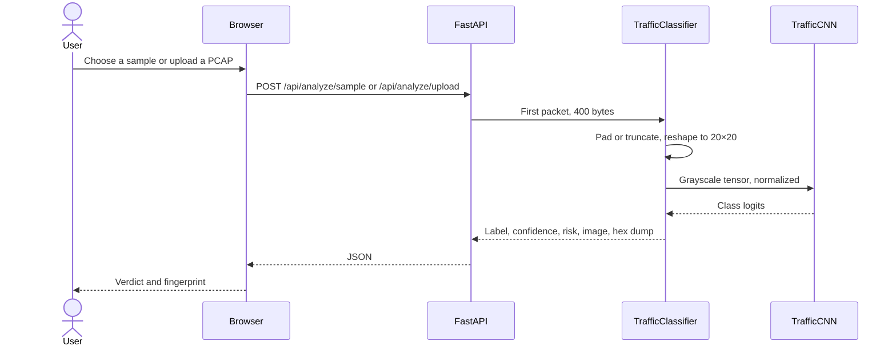

# TrafficScan AI

**PCAP-to-image malware fingerprinting.** Raw network captures are turned into grayscale images and classified by a convolutional network as **benign**, **botnet**, or **DDoS**.

Signature rules break when traffic changes shape. TrafficScan treats the byte layout of a packet as a spatial pattern: each byte becomes a pixel, and a small CNN learns which textures belong to normal office traffic, ARES botnet command-and-control, and high-volume denial-of-service. The result is a local web dashboard that accepts a capture or a prebuilt sample and returns a class, a confidence, a risk level, and the fingerprint image itself.

This is a Computer Networks course project (Unit II data-link framing, Unit V network security). The reported model is the chronological hold-out result on the 400-byte representation: **74.00% accuracy**, macro F1 **0.7418**.

## Architecture



Training and serving share the same representation. Offline scripts in `data_processing/` build the image dataset; `ml/train_packet_compact.py` fits the network on a chronological split and writes the checkpoint. At request time the API loads that checkpoint once, turns the submitted capture into a 20×20 tensor, and returns probabilities plus a zoomed fingerprint for the page.



Demo mode is a presentation path, not a second model. A toggle on the dashboard appends `?demo=true`. The server then answers from `demo/demo_classifier.py` using the known filename. Real inference omits that flag and reads only pixel values from `packet_compact_model.pth`.

## What the fingerprint is

One Ethernet frame becomes one image.

| Step | Rule |
|------|------|
| Capture | First packet of the PCAP, raw frame bytes via Scapy |
| Window | First **400** bytes; shorter frames are zero-padded, longer frames are truncated |
| Image | Row-major reshape to **20×20**, one byte per pixel, saved as grayscale PNG |
| Label folders | `benign`, `botnet`, `ddos` |

The training corpus is three 100 MiB slices of [CIC-IDS2017](https://www.unb.ca/cic/datasets/ids-2017.html) (Sharafaldin, Lashkari, Ghorbani, ICISSP 2018), taken from the Hugging Face mirror `bvsam/cic-ids-2017`:

| Class | File | Day |
|-------|------|-----|
| benign | `Monday-WorkingHours_slice100MB.pcap` | Monday, normal working hours |
| ddos | `Wednesday-workingHours_slice100MB.pcap` | Wednesday, DoS / DDoS |
| botnet | `Friday-WorkingHours_slice100MB.pcap` | Friday, ARES botnet |

Earlier experiments also used a 64×64 / 4,096-byte window. The checkpoint the API loads is the 20×20 compact model, and inference follows that layout.

## Model

`TrafficCNN` in `ml/model.py` is a three-block convolutional network with a small fully connected head. It accepts a single-channel image of any spatial size because the head uses adaptive average pooling to 4×4.

| Block | Layers |
|-------|--------|
| Conv 1 | 1 → 32, 3×3, padding 1, BatchNorm, ReLU, MaxPool 2 |
| Conv 2 | 32 → 64, same pattern |
| Conv 3 | 64 → 128, same pattern |
| Head | AdaptiveAvgPool 4×4, Linear 2048 → 128, ReLU, Dropout 0.4, Linear 128 → 3 |

Training (`ml/train_packet_compact.py`) uses Adam at learning rate `0.001`, weight decay `1e-4`, cross-entropy with class weights `[1.10, 1.20, 0.90]`, up to 30 epochs, and early stopping with patience 7. Images are ordered by filename and split per class into the first 1,400 for training, the next 300 for validation, and the remainder for test, so later packets in a capture are not mixed into training.

## Reported result

Evaluated on the chronological hold-out of `data/processed_packet_compact` with `ml/checkpoints/packet_compact_model.pth`:

| Metric | Value |
|--------|--------|
| Accuracy | **74.00%** |
| Macro F1 | **0.7418** |

A random split of the same images reached 94.67%. Adjacent packets inside one capture are highly correlated, so that figure overstates performance on unseen traffic. Cross-capture evaluation is not finished. The 74% chronological number is the result this repository stands behind.

Other representations (4,096-byte streams, 64×64 packet-aligned frames, 16×16 / 256-byte crops, metadata-only features) are recorded in `ml/EXPERIMENT_LOG.md`. The compact 400-byte image is the best chronological result among them.

## Repository

| Path | Role |
|------|------|
| `data/raw/` | Source PCAPs, stored with Git LFS |
| `data/processed_packet_compact/` | 20×20 images used by the current model |
| `data_processing/` | PCAP reading and byte-to-image conversion |
| `ml/` | `TrafficCNN`, training scripts, evaluation, checkpoints |
| `classification/` | Inference: image, probabilities, entropy, hex dump |
| `api/` | FastAPI service and static file hosting |
| `frontend/` | Dashboard (`index.html`, `app.js`, `styles.css`) |
| `demo/` | Presentation-mode classifier and sample images |
| `docs/` | Design notes, project guide, syllabus mapping |

## Run the dashboard

Python 3.10+ on Windows. GPU is optional; the server falls back to CPU.

```powershell
python -m venv .venv
.\.venv\Scripts\Activate.ps1
pip install -r requirements.txt
git lfs pull
python -m uvicorn api.server:app --reload
```

Open [http://127.0.0.1:8000](http://127.0.0.1:8000). The header reports engine status, model name, and compute device. Pick a bundled sample or upload a `.pcap`, `.pcapng`, or grayscale image.

`requirements.txt` installs NumPy, Pillow, Scapy, PyTorch, torchvision, scikit-learn, FastAPI, and Uvicorn.

## API

| Method | Path | Purpose |
|--------|------|---------|
| `GET` | `/api/health` | Model loaded, class names, device, checkpoint file |
| `GET` | `/api/samples` | Bundled PCAPs and whether each file is on disk |
| `POST` | `/api/analyze/sample` | Body `{"sample_id": "benign" \| "ddos" \| "botnet"}` |
| `POST` | `/api/analyze/upload` | Multipart file: PCAP or PNG/JPEG |

Add `?demo=true` to either analyze route to use the presentation classifier. A real response includes `prediction`, `confidence`, per-class `probabilities`, `risk_level` (`LOW`, `HIGH`, or `CRITICAL`), the fingerprint as a base64 PNG, byte telemetry, and a short hex dump.

Interactive docs are at [http://127.0.0.1:8000/docs](http://127.0.0.1:8000/docs) while the server is running.

## Retrain

Build images, then train. Processed trees are large and are not all committed; raw slices come in through Git LFS.

```powershell
python data_processing/packet_compact_convert.py
python ml/train_packet_compact.py
```

The training script writes `ml/checkpoints/packet_compact_model.pth`. Retraining can move the accuracy slightly because early stopping depends on the validation curve. Evaluation procedure and the locked 74% check are in `docs/PROJECT_GUIDE.md`.

## Limits

- Each class currently comes from a single 100 MiB slice, so the model has not been proven on an independent capture.
- Wednesday and Friday slices begin at the start of the day file. Early packets can precede the labeled attack window.
- Random train/test splits on one PCAP leak neighboring packets across the split. Use the chronological protocol when quoting accuracy.
- Demo mode returns scripted high-confidence labels for known filenames. It is for walking through the interface, and it is separate from the checkpoint.

## Further reading

- [docs/PROJECT_GUIDE.md](docs/PROJECT_GUIDE.md) — setup, reproduction, experiment history
- [docs/abstract.md](docs/abstract.md) — problem statement
- [ml/EXPERIMENT_LOG.md](ml/EXPERIMENT_LOG.md) — every representation and split that was tried
- [docs/HOW_TO_TEST_DEMO.md](docs/HOW_TO_TEST_DEMO.md) — dashboard walkthrough
