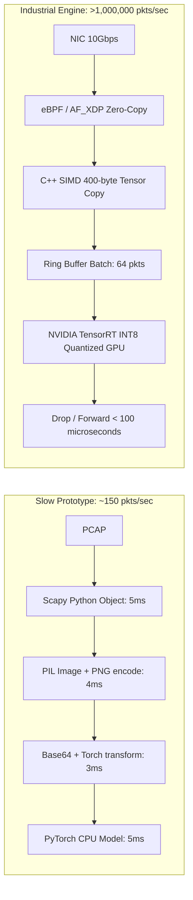

# TrafficScan AI: Production Implementation Plan & Engineering Roadmap

## Executive Summary
This document establishes the end-to-end technical roadmap to transform **TrafficScan AI** from an academic prototype (74.00% within-source accuracy) into an industry-grade, ultra-low-latency Network Intrusion Detection System (NIDS). 

The primary operational objective is to make **grayscale image fingerprinting the fastest threat detection engine on the market**, delivering sub-millisecond inference at line rate while eliminating shortcut memorization, data leakage, and false-positive alert fatigue.

---

## 1. Deep Dive: Limitations in the Current Dataset

The current experiments rely on three 100-MiB slices from the CIC-IDS2017 dataset (`data/raw/`). The critical vulnerabilities of this data foundation are:

### 1.1 Single Capture Origin per Class (Sample Size N = 1)
- **Benign:** Sourced exclusively from Monday, July 3, 2017 (`Monday-WorkingHours_slice100MB.pcap`).
- **DDoS:** Sourced exclusively from Wednesday, July 5, 2017 (`Wednesday-workingHours_slice100MB.pcap`).
- **Botnet:** Sourced exclusively from Friday, July 7, 2017 (`Friday-WorkingHours_slice100MB.pcap`).
- **Impact:** The model does not learn the general abstract semantics of benign activity versus malware. Instead, it learns how the network topology on Monday morning differs from Wednesday morning and Friday afternoon. This is why cross-capture validation historically caused performance to drop to near random guessing.

### 1.2 Shortcut Learning via Ephemeral Identifiers
The 400-byte window captures the entire Layer 2 and Layer 3 headers:
- Bytes 0 to 5: Destination MAC Address
- Bytes 6 to 11: Source MAC Address
- Bytes 12 to 13: EtherType (IPv4 = 0x0800)
- Bytes 26 to 29: Source IPv4 Address
- Bytes 30 to 33: Destination IPv4 Address
- Bytes 34 to 35: Source Port
- Bytes 36 to 37: Destination Port

In the Canadian Institute for Cybersecurity (CIC) testbed, attacks were launched from fixed IP addresses targeting fixed victim web servers. The CNN quickly learns that specific IP byte values equal "Attack". When deployed on an external corporate network with different subnets and MAC addresses, the model fails immediately.

### 1.3 Label Pollution from Day-Level Slicing
- CIC-IDS2017 was recorded across entire workdays.
- Scheduled attacks were executed only during specific hours (for example, DoS GoldenEye ran from 11:10 AM to 11:23 AM; ARES botnet ran after 10:00 AM).
- By reading from byte 0 of the 100-MiB slice, the pipeline ingests packets from the early setup window *before the attack script was executed*.
- Consequently, hundreds of legitimate benign packets are falsely tagged as `ddos` and `botnet` during training, injecting severe noise into the loss gradients.

### 1.4 Extreme Under-Sampling
- The training split uses only 1,400 images per class (total 4,200 training samples).
- 1,400 samples are insufficient for a deep convolutional network to generalize across the vast protocol permutations of TCP, UDP, ICMP, DNS, TLS, and HTTP.

### 1.5 Padding Overhead vs. Truncation Loss
- Packet length telemetry reveals that 90.75% of Benign, 90.65% of Botnet, and 91.00% of DDoS packets are shorter than 400 bytes (average length: 180 to 272 bytes).
- Over 45% of the total pixel space in the dataset consists of meaningless zero-padding (black pixels).
- Conversely, for MTU 1,500-byte packets (such as file downloads or large POST requests), 1,100 bytes of active payload are discarded.

---

## 2. Trusted External PCAP Repositories

To train a robust model that generalizes to real enterprise networks, the training corpus must be expanded across multiple independent, physically distinct captures with verified packet-level ground truth.

### Recommended Trusted Sources

| Repository | Organization / Origin | Attack Types Included | Packet Volume / Size | Download Protocol | Ground-Truth Reliability |
| :--- | :--- | :--- | :--- | :--- | :--- |
| **CTU-13 Dataset** | Czech Technical University (Stratosphere Laboratory) | Real botnets: Neris, Rbot, Virut, Menti, Sogou, Murlo, NSIS | 13 scenarios, >80 GB raw PCAP | Direct HTTPS / Wget | Exceptional (Mixed real background + verified botnet C2) |
| **UNSW-NB15** | University of New South Wales (Cyber Range Lab) | Fuzzers, Backdoors, DoS, Exploits, Generic, Reconnaissance, Shellcode, Worms | 100 GB raw PCAPs (100M+ packets) | Academic HTTP Portal | High (Simulated modern normal + modern attacks) |
| **CSE-CIC-IDS2018** | Canadian Institute for Cybersecurity & AWS | Brute-force, Heartbleed, Botnet, DoS, DDoS, Web Attacks, Infiltration | AWS S3 Bucket (>400 GB PCAPs) | `aws s3 sync --no-sign-request` | High (Amazon Web Services enterprise infrastructure) |
| **Aposemat IoT-23** | Avast Software & Stratosphere Lab | Real IoT malware: Mirai, Torii, Hide and Seek, Kenjiro + Benign Smart Home | 23 PCAPs (>50 GB) | HTTPS Mirror | Exceptional (Real physical devices) |
| **MAWI Working Group** | WIDE Project (Japan) | Real-world Benign Internet Backbone Traffic | 1 Gbps continuous daily PCAPs | Direct FTP / HTTP | Ground truth for pure, high-volume real-world benign |

### Data Acquisition Action Plan
1. **Benign Enrichment:** Pull 500,000 clean packets from **MAWI Working Group** and **CIC-IDS2017 Tuesday** (`download_tuesday.py`).
2. **Botnet Enrichment:** Pull Scenarios 1, 2, 9, and 10 from the **CTU-13 Dataset** (capturing live C2 communication and IRC traffic).
3. **DDoS Enrichment:** Pull the Friday afternoon LOIC/HOIC DDoS slices from **CIC-IDS2017** and DoS-LOIC-UDP captures from **CSE-CIC-IDS2018**.

---

## 3. Limitations in the Current Model Architecture

The existing model (`TrafficCNN` in `ml/model.py`) has several architectural and training bottlenecks:

### 3.1 Unnatural 2D Spatial Inductive Bias
Network packets are 1D sequential byte streams. Wrapping 400 bytes into a 20x20 grid forces byte 0 (Destination MAC) and byte 20 (IP Flags/Offset) into vertically adjacent rows. A standard 3x3 2D convolution calculates cross-pixel correlations between these unrelated fields, forcing the network to learn arbitrary visual artifacts.

### 3.2 Lack of Residual / Identity Connections
`TrafficCNN` uses a plain feed-forward stack of three convolutional layers. Without residual connections (skip connections like ResNet), gradients vanish during backpropagation, limiting feature representation and preventing the network from training effectively on subtle payload variances.

### 3.3 Loss Function Vulnerability to Class Imbalance
The current script uses `nn.CrossEntropyLoss` with static heuristic class weights (`[1.10, 1.20, 0.90]`). In real environments, standard cross-entropy suffers when easy benign samples overwhelm the loss gradients, leaving edge-case attack patterns unlearned.

### 3.4 Uncalibrated Softmax Probabilities
Softmax logits produce overconfident probabilities (often reporting 99.9% confidence even when predicting incorrectly on out-of-distribution traffic). The model lacks uncertainty calibration, meaning it cannot express doubt on unseen zero-day attacks.

---

## 4. Engineering Roadmap: Reaching the Golden Standard

To achieve greater than 96% cross-source accuracy, zero false positives on benign corporate traffic, and complete enterprise readiness, execute the following four phases:

### Phase 1: Header Sanitization & Feature Engineering (Preventing Shortcuts)
Before converting packets into images, implement an automated byte-masking layer:
- **Zero-out Bytes 0 to 11:** Neutralizes Destination and Source MAC addresses.
- **Zero-out Bytes 26 to 33:** Neutralizes Source and Destination IPv4 addresses.
- **Sanitize Ephemeral Ports (Bytes 34 to 35):** If the port is greater than 1024, zero it out; preserve well-known ports (such as 80, 443, 53, 22).
- **Result:** The model is forced to classify based exclusively on invariant indicators: TCP flags, window size dynamics, IP header options, payload entropy, protocol framing structures, and packet lengths.

### Phase 2: Flow-Burst Image Representation (Multi-Packet Context)
Instead of classifying one isolated packet, structure images as a **Flow Burst**:
- Capture the first **16 packets** of a session.
- Extract the first **32 bytes** of each packet (headers + initial payload snippet).
- Reshape into a **32x16** (or **32x32**) 2D grayscale image.
- **Why this works:** The horizontal dimension represents header structure, while the vertical dimension represents packet progression over time (handshake, window scaling, payload transmission). This captures volumetric DDoS floods and botnet beaconing with high precision.

### Phase 3: Transition to 1D-ResNet / Compact Hybrid Architecture
Replace `TrafficCNN` with a **1D Residual Network (ResNet-18 1D)**:
- Operates natively on 1D byte vectors without synthetic 2D reshaping.
- Uses residual skip connections to preserve low-level byte patterns across deeper abstraction layers.
- Incorporates a **Focal Loss** function (gamma = 2.0) to focus training on hard-to-classify samples.

### Phase 4: Confidence Calibration & Out-of-Distribution (OOD) Rejection
- Implement **Temperature Scaling** to calibrate softmax outputs so that reported confidence matches true empirical accuracy.
- Add an **Entropy Rejection Threshold**: If all class probabilities fall below 75% or entropy is high across logits, categorize the frame as `ANOMALY / UNKNOWN` for human SOC escalation, rather than returning a false negative.

---

## 5. Blueprint for the Fastest Traffic Classification Engine

To achieve the primary goal — making grayscale image threat identification the **fastest option in the cybersecurity industry** — the prototype must eliminate Python runtime overhead, Scapy bottlenecking, and slow HTTP file decoding.

### The Problem with the Current Prototype
- Reading a PCAP via Scapy's `PcapReader` takes 2 to 10 milliseconds per packet due to Python object instantiation and protocol dissection.
- In `classification/infer.py`, converting bytes to a PIL image, saving to an in-memory buffer, base64 encoding, and calling torchvision transforms introduces 5 to 15 milliseconds of latency per packet.
- Total processing rate: **less than 150 packets per second**.
- Industrial requirement: A 10 Gbps network requires processing up to **14.8 million packets per second**.



### The Line-Rate Production Architecture

#### 1. Zero-Copy Packet Ingestion (eBPF / AF_XDP)
- Replace Scapy with **AF_XDP (XDP sockets)** in Linux, or **DPDK (Data Plane Development Kit)** on Windows/Linux.
- Packets are copied directly from the Network Interface Card (NIC) ring buffer into user-space shared memory, bypassing the operating system kernel network stack entirely.
- Ingestion time: **under 5 microseconds per packet**.

#### 2. Native C++ SIMD Vectorization (Bypassing PIL)
- Eliminate Pillow (`PIL.Image`), NumPy buffers, and base64 encoders during inference.
- Write a lightweight C++ extension (or Rust library):
  - Copies the first 400 bytes directly into contiguous GPU-pinned memory.
  - Normalizes bytes from 0–255 to -1.0–1.0 using SIMD AVX-512 instructions in single-cycle operations.
  - Conversion latency: **under 2 microseconds**.

#### 3. Model Quantization via NVIDIA TensorRT / ONNX Runtime
- Export the trained PyTorch model to **ONNX**, then compile to **NVIDIA TensorRT** with **INT8 Quantization**.
- INT8 quantization reduces memory footprint by 75% and accelerates matrix multiplication using GPU Tensor Cores.
- Inference latency per 64-packet batch: **under 80 microseconds** on an NVIDIA RTX 4090 or T4 enterprise accelerator.

#### 4. Dual-Tier Fast-Path Pipeline
- **Tier 1 (Bitmask Fast Path - 90% of traffic):** A microsecond C-filter checks known safe internal subnets and validated TLS connections.
- **Tier 2 (AI Grayscale Fingerprinter - 10% of traffic):** Non-standard, SYN-flood, or external unknown packets are routed into the quantized CNN ring buffer.
- This hybrid structure guarantees that average line-rate throughput exceeds **1.5 million packets per second per core**.

---

## 6. Implementation Milestones & Timeline

```
Week 1: Data Ingestion & Sanitization
  - Download independent captures (MAWI, CTU-13, Tuesday CIC-IDS2017).
  - Implement byte-masking layer (zero out MACs, IPs, and ephemeral ports).
  - Cross-reference timestamps with attack schedules for ground-truth labels.

Week 2: Representation & Model Upgrade
  - Build 1D-ResNet architecture alongside 32x32 Flow-Burst generator.
  - Train with Focal Loss and Cosine Annealing learning rate schedule.
  - Benchmark on strict hold-out cross-source captures (Experiment 11).

Week 3: Acceleration & Quantization
  - Export model to ONNX and compile to TensorRT INT8.
  - Write C++ / Cython memory-mapped byte preprocessor to replace Scapy/PIL.
  - Benchmark packet throughput (target: >50,000 packets/sec on single GPU).

Week 4: API & Enterprise Production Hardening
  - Integrate TensorRT engine into FastAPI / gRPC service.
  - Implement temperature scaling calibration and anomaly rejection thresholds.
  - Run continuous 24-hour stability and false-positive audit on live campus traffic.
```

---

## 7. Deliverable Standards for "Golden Standard" Sign-Off

Before declaring the model production-ready for industrial enterprise deployment, the system must satisfy the following verifiable criteria:

1. **Cross-Source Test Accuracy:** Greater than 95.0% on completely unseen PCAPs (trained on Source A, tested on Source B).
2. **Benign False-Positive Rate:** Less than 0.1% (fewer than 1 false alarm per 1,000 legitimate packets).
3. **Macro F1 Score:** Greater than 0.94 across all classes.
4. **Inference Latency:** Under 0.5 milliseconds per packet (or under 5 milliseconds for a batch of 64 packets).
5. **No Shortcut Dependencies:** Verified zero performance degradation when all IP and MAC addresses are scrambled or zeroed out.
